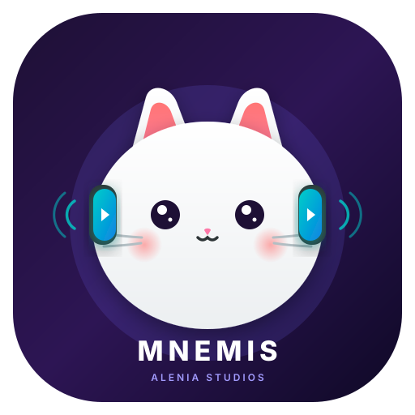

<p align="center">
  
</p>

<h1 align="center">Mnemis</h1>

<p align="center">
  <a href="https://github.com/Kaia-Alenia/Mnemis/actions/workflows/android.yml"></a>
  <a href="https://github.com/Kaia-Alenia/Mnemis"></a>
  <a href="https://kotlinlang.org/"></a>
  <a href="https://gradle.org/"></a>
  <a href="https://github.com/Kaia-Alenia/Mnemis/blob/main/SECURITY.md"></a>
</p>

<p align="center"><b>Un reproductor de video extensible para Android con salas nativas de KoalaSync.</b></p>

**Mnemis es un reproductor de video extensible para Android desarrollado por Alenia Studios.**

Reúne la reproducción local, los streams web directos y las salas sincronizadas en un solo reproductor. Su integración nativa con KoalaSync permite que varias personas entren a una sala y coordinen las acciones de reproducir, pausar y buscar mientras ven fuentes compatibles.

[Read this in English](README.md)

## Qué hace Mnemis

- Reproduce archivos de video locales y URLs multimedia HTTP(S) directas.
- Usa AndroidX Media3, incluyendo soporte para HLS y DASH.
- Resuelve enlaces compatibles de YouTube, Google Drive, Dropbox y streams MP4/HLS.
- Abre reproductores web mediante WebView cuando una fuente lo necesita.
- Soporta picture-in-picture e intents de video comunes de Android.
- Se conecta a salas de KoalaSync mediante un cliente WebSocket nativo.
- Sincroniza reproducción entre participantes: play, pause, seek, miembros y modos de control.
- Ofrece una base para plugins de fuentes y reproducción, de modo que las integraciones puedan evolucionar sin modificar el núcleo.

## Salas de reproducción con KoalaSync

KoalaSync es la integración nativa de Mnemis para ver contenido en grupo. Una persona puede crear o unirse a una sala, proporcionar opcionalmente un nombre visible y una contraseña, y compartir acciones de reproducción con los demás participantes.

La integración admite:

- Salas identificadas mediante un room ID.
- Modos de control `everyone` y `host-only`.
- Sincronización con números de secuencia y corrección de desfase.
- Heartbeat y reconexión automática.
- Reproducción web mediante un puente JavaScript para fuentes HTML5.

KoalaSync sincroniza comandos y metadatos de reproducción; no copia ni redistribuye el contenido. Cada participante debe tener derecho a acceder al material que reproduce.

## Fuentes compatibles

| Fuente | Comportamiento actual |
| --- | --- |
| Archivos locales | Se abren mediante intents de video y el selector de archivos de Android |
| MP4 y streams progresivos directos | Se reproducen con Media3 |
| HLS (`.m3u8`) | Se reproduce con el módulo HLS de Media3 |
| DASH | Compatible mediante el módulo DASH de Media3 |
| Enlaces de YouTube | Se resuelven cuando la respuesta de la fuente lo permite; puede cambiar |
| Enlaces de Google Drive | Se convierten a una URL directa cuando son accesibles |
| Enlaces de Dropbox | Se admiten enlaces de descarga directa |
| Otros sitios web | Se abren en el reproductor web cuando son compatibles |

Las plataformas externas pueden cambiar sus APIs, autenticación, términos o formatos. Mnemis no garantiza compatibilidad permanente con servicios externos.

## Arquitectura de plugins

Mnemis está diseñado alrededor de integraciones reemplazables de fuentes multimedia y reproducción. La integración nativa de KoalaSync es la primera integración de referencia con forma de plugin. El contrato público de plugins todavía está evolucionando; consulta [Desarrollo de plugins](docs/PLUGIN_DEVELOPMENT.md) antes de crear una integración externa.

Los plugins deben:

1. Declarar las fuentes y permisos que necesitan.
2. Devolver metadatos normalizados y una fuente reproducible.
3. Mantener el código específico de cada plataforma fuera del núcleo.
4. No recopilar datos que no sean necesarios para reproducir.
5. Manejar los errores explícitamente y respetar las reglas de la plataforma.

## Compilación

### Requisitos

- Android Studio Hedgehog o posterior.
- JDK 17.
- Android SDK 34.
- Un dispositivo o emulador Android con API 24 o posterior.

### Comandos

```bash
./gradlew assembleDebug
./gradlew test
```

Instala el APK de debug desde `app/build/outputs/apk/debug/` en un dispositivo de prueba. No uses cuentas de producción ni credenciales privadas de medios en builds de debug.

## Privacidad y seguridad

Mnemis necesita acceso a la red para resolver contenido remoto y conectarse a KoalaSync. Los participantes de una sala pueden recibir metadatos como peer ID, nombre visible, título del medio y posición de reproducción. Consulta [PRIVACY.md](PRIVACY.md) y [SECURITY.md](SECURITY.md).

No incluyas claves API, contraseñas de salas, cookies ni credenciales personales en issues, pull requests, logs o código. Si encuentras un problema de seguridad, repórtalo de forma privada siguiendo [SECURITY.md](SECURITY.md).

## Contribuir

Son bienvenidos los reportes de errores, integraciones de fuentes, traducciones, pruebas y mejoras de documentación. Lee primero [CONTRIBUTING.md](CONTRIBUTING.md) y [CODE_OF_CONDUCT.md](CODE_OF_CONDUCT.md).

## Soporte

Para preguntas de uso y solicitudes de funciones, consulta [SUPPORT.md](SUPPORT.md). Incluye la versión de Mnemis, versión de Android, tipo de fuente y pasos reproducibles sin compartir contenido privado ni credenciales.

## Licencia

Este repositorio todavía no publica una licencia. Hasta que se agregue una, todos los derechos permanecen con el titular del copyright y no debe asumirse autorización de reutilización.
