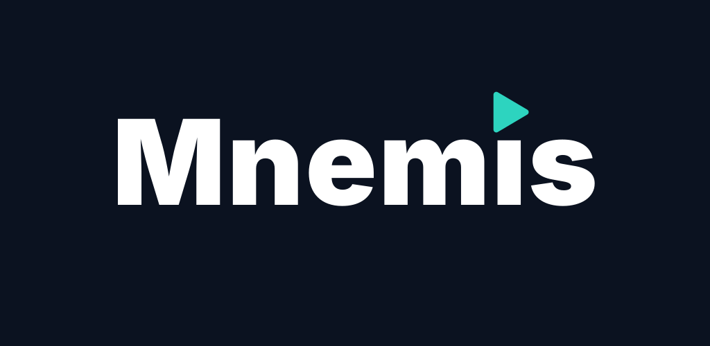
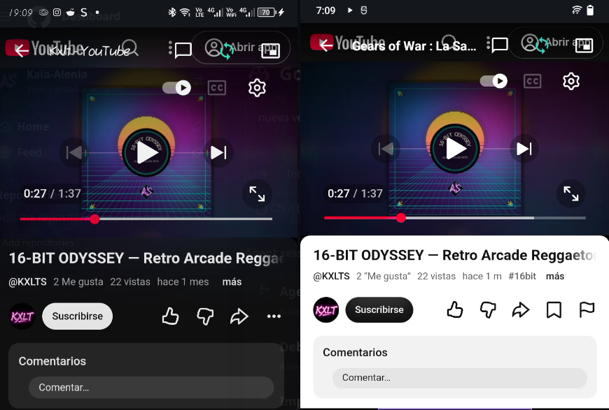
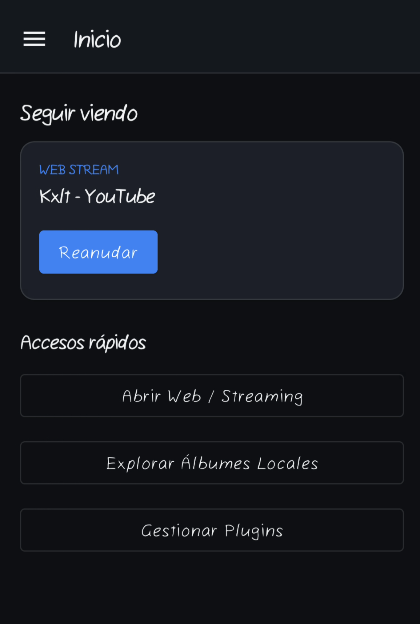
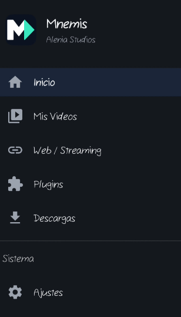
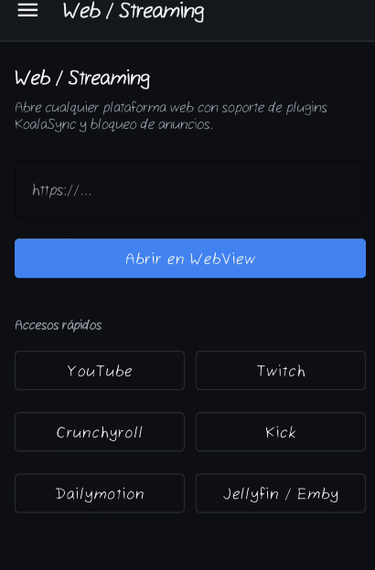
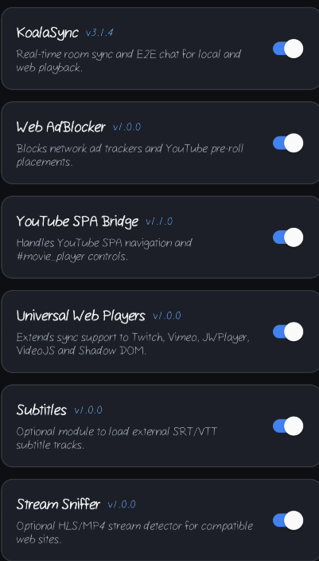
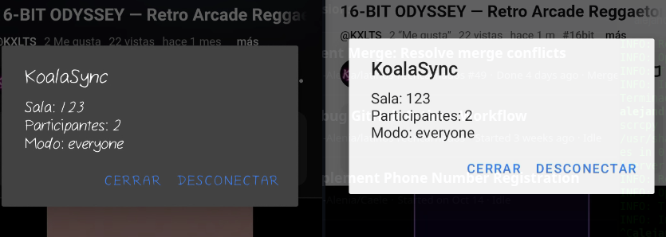
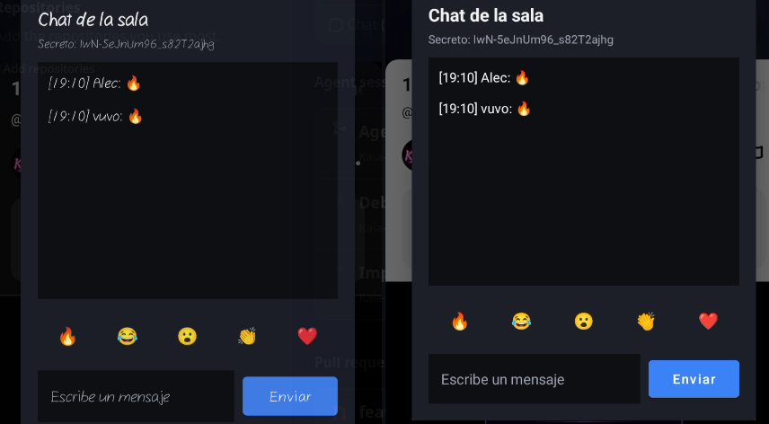

<p align="center">
  
</p>

<h1 align="center">Mnemis</h1>

<p align="center">
  <a href="https://github.com/Kaia-Alenia/Mnemis/actions/workflows/android.yml"></a>
  <a href="https://github.com/Kaia-Alenia/Mnemis/releases"></a>
  <a href="LICENSE"></a>
  <a href="https://github.com/Kaia-Alenia/Mnemis"></a>
  <a href="https://kotlinlang.org/"></a>
  <a href="https://gradle.org/"></a>
</p>

<p align="center"><i>Un reproductor de video extensible para Android con salas nativas de KoalaSync. Reproduce archivos locales, streams directos y reproductores web en un solo lugar, y mira contenido en grupo y en sincronía.</i></p>

<p align="center"><a href="CHANGELOG.md"><b>Última versión: v1.0.9</b> — Ver qué cambió en el Changelog</a></p>

**Mnemis es un reproductor de video extensible para Android desarrollado por Alenia Studios.**

Reúne la reproducción local, los streams web directos y las salas sincronizadas en un solo reproductor. Su integración nativa con KoalaSync permite que varias personas entren a una sala y coordinen las acciones de reproducir, pausar y buscar mientras ven fuentes compatibles.

[Read this in English](README.md)

## Vista previa

<p align="center">
  
  <br>
  <sub><b>Watch Party Mnemis a Mnemis:</b> dos dispositivos Android conectados a la misma sala de KoalaSync reproduciendo exactamente el mismo video en sincronía (0:27 / 1:37).</sub>
</p>

<table>
  <tr>
    <td align="center" width="25%">
      
      <br><sub><b>Inicio y Seguir viendo</b></sub>
    </td>
    <td align="center" width="25%">
      
      <br><sub><b>Menú de navegación</b></sub>
    </td>
    <td align="center" width="25%">
      
      <br><sub><b>Web / Streaming</b></sub>
    </td>
    <td align="center" width="25%">
      
      <br><sub><b>Plugins modulares</b></sub>
    </td>
  </tr>
</table>

<table>
  <tr>
    <td align="center" width="50%">
      
      <br><sub><b>Estado de la sala KoalaSync</b> — participantes en vivo y modo de control</sub>
    </td>
    <td align="center" width="50%">
      
      <br><sub><b>Chat E2E en vivo</b> — mensajes cifrados y reacciones rápidas</sub>
    </td>
  </tr>
</table>

## Por qué Mnemis

- **Primero los plugins**: El núcleo del reproductor se mantiene pequeño. Las fuentes y las integraciones de reproducción son plugins, así que se pueden agregar nuevos servicios sin cambiar el núcleo.
- **Ver en grupo**: Salas nativas de KoalaSync con sincronización de play, pausa y seek, controles de anfitrión y reconexión automática.
- **Reproduce casi todo**: Archivos locales, streams directos MP4/HLS/DASH, enlaces de YouTube, Google Drive y Dropbox, y reproductores web mediante WebView.
- **Basado en Media3**: Reproducción con AndroidX Media3, con soporte para HLS y DASH, picture-in-picture e intents de video estándar de Android.
- **Abierto y privado**: Código abierto bajo la licencia MIT. No se necesita cuenta para reproducir contenido local o directo, y la integración de sincronización no copia ni redistribuye el contenido.

## Características principales

- **Reproducción local**: Abre archivos de video desde el almacenamiento con el selector de archivos del sistema y los intents de video de Android.
- **Streams directos**: Reproduce URLs multimedia HTTP(S) directas, incluyendo MP4 progresivo, HLS (`.m3u8`) y DASH.
- **Resolución de enlaces**: Convierte enlaces compatibles de YouTube, Google Drive y Dropbox en streams reproducibles cuando la fuente lo permite.
- **Reproductores web**: Abre reproductores web mediante WebView cuando una fuente lo necesita.
- **Salas de KoalaSync**: Crea una sala o únete a una, define un nombre visible y una contraseña opcional, y sincroniza la reproducción con los demás participantes. Ver [Salas de reproducción con KoalaSync](#salas-de-reproducción-con-koalasync) más abajo.
- **Picture-in-picture**: Sigue viendo mientras usas otras aplicaciones.
- **Plugins incluidos**: Mnemis incluye cuatro plugins integrados:
  - **KoalaSync** — salas sincronizadas por WebSocket, con estado de sala, heartbeat y corrección de desfase.
  - **Web AdBlocker** — bloquea rastreadores de anuncios de red y anuncios pre-roll de YouTube en la reproducción web.
  - **YouTube SPA Bridge** — gestiona la navegación de la app de una sola página de YouTube y los controles de `#movie_player`.
  - **Universal Web Players** — agrega soporte de reproducción para reproductores web genéricos mediante scripts de usuario inyectados.

## Inicio rápido

### Requisitos

- Android Studio Hedgehog o posterior.
- JDK 17.
- Android SDK 34.
- Un dispositivo o emulador Android con API 24 o posterior.

### Compilación e instalación

```bash
./gradlew assembleDebug
./gradlew test
```

Instala el APK de debug desde `app/build/outputs/apk/debug/` en un dispositivo de prueba. No uses cuentas de producción ni credenciales privadas de medios en builds de debug.

Las versiones etiquetadas también se compilan en CI (`.github/workflows/android.yml`), que ejecuta las pruebas, compila el APK de debug y lo publica como release de GitHub. Descarga el APK más reciente desde la [página de releases](https://github.com/Kaia-Alenia/Mnemis/releases).

### Cómo usarlo

1. Abre Mnemis y elige un video: un archivo local, una URL de stream directo o un enlace compatible.
2. Para ver en grupo, abre el panel de KoalaSync, crea una sala o únete a una con su room ID, y comparte ese ID con tus amigos.
3. Reproduce, pausa o busca en el video: todos en la sala se mantienen en sincronía.

## Fuentes compatibles

| Fuente | Comportamiento actual |
| --- | --- |
| Archivos locales | Se abren mediante intents de video y el selector de archivos de Android |
| MP4 y streams progresivos directos | Se reproducen con Media3 |
| HLS (`.m3u8`) | Se reproduce con el módulo HLS de Media3 |
| DASH | Compatible mediante el módulo DASH de Media3 |
| Enlaces de YouTube | Se resuelven cuando la respuesta de la fuente lo permite; puede cambiar |
| Enlaces de Google Drive | Se convierten a una URL directa cuando son accesibles |
| Enlaces de Dropbox | Se admiten enlaces de descarga directa |
| Otros sitios web | Se abren en el reproductor web cuando son compatibles |

Las plataformas externas pueden cambiar sus APIs, autenticación, términos o formatos. Mnemis no garantiza compatibilidad permanente con servicios externos.

## Salas de reproducción con KoalaSync

KoalaSync es la integración nativa de Mnemis para ver contenido en grupo. Una persona puede crear o unirse a una sala, proporcionar opcionalmente un nombre visible y una contraseña, y compartir acciones de reproducción con los demás participantes.

La integración admite:

- Salas identificadas mediante un room ID.
- Modos de control `everyone` y `host-only`.
- Sincronización con números de secuencia y corrección de desfase.
- Sincronización automática de siguiente video liderada por el anfitrión: cuando termina un video y avanza por reproducción automática (o el líder cambia de video), los demás Mnemis de la sala siguen automáticamente el mismo video.
- Heartbeat y reconexión automática.
- Reproducción web mediante un puente JavaScript para fuentes HTML5.

KoalaSync sincroniza comandos y metadatos de reproducción; no copia ni redistribuye el contenido. Cada participante debe tener derecho a acceder al material que reproduce.

KoalaSync es un proyecto independiente de código abierto creado por Shik3i. Más información en el [sitio web de KoalaSync](https://sync.koalastuff.net/) y en el [repositorio de KoalaSync en GitHub](https://github.com/Shik3i/KoalaSync). Los detalles técnicos de la integración en Mnemis están en [docs/KOALASYNC.md](docs/KOALASYNC.md).

## Localización

Mnemis incluye traducciones de la interfaz para estos idiomas:

- Inglés (`en`)
- Alemán (`de`)
- Español (`es`)
- Francés (`fr`)
- Italiano (`it`)
- Japonés (`ja`)
- Coreano (`ko`)
- Neerlandés (`nl`)
- Polaco (`pl`)
- Portugués (`pt`)
- Portugués brasileño (`pt-BR`)
- Ruso (`ru`)
- Turco (`tr`)
- Ucraniano (`uk`)
- Chino simplificado (`zh-CN`)

Las traducciones de la comunidad son bienvenidas. Si puedes traducir Mnemis a otro idioma, consulta [CONTRIBUTING.md](CONTRIBUTING.md).

## Desarrollo de plugins

Mnemis está diseñado alrededor de integraciones reemplazables de fuentes multimedia y reproducción. La integración nativa de KoalaSync es la primera integración de referencia con forma de plugin. El contrato público de plugins todavía está evolucionando; consulta [Desarrollo de plugins](docs/PLUGIN_DEVELOPMENT.md) antes de crear una integración externa.

Los plugins deben:

1. Declarar las fuentes y permisos que necesitan.
2. Devolver metadatos normalizados y una fuente reproducible.
3. Mantener el código específico de cada plataforma fuera del núcleo.
4. No recopilar datos que no sean necesarios para reproducir.
5. Manejar los errores explícitamente y respetar las reglas de la plataforma.

## Estructura del proyecto

```text
app/src/main/java/com/alenia/mnemis/
  model/       Modelos de medios
  player/      Reproducción con Media3 y gestos
  plugin/      Plugins incluidos y registro de plugins
  resolver/    Resolución de enlaces y fuentes
  sync/        Cliente KoalaSync, protocolo y puente WebView
  ui/          Actividades y adaptadores de Android
src/android/   Código Android compartido para resolución
assets/        Recursos de marca
docs/          Documentación técnica
```

## Documentación y enlaces

- **[docs/KOALASYNC.md](docs/KOALASYNC.md)**: Integración con KoalaSync, ciclo de una sala, eventos y reproducción web.
- **[docs/PLUGIN_DEVELOPMENT.md](docs/PLUGIN_DEVELOPMENT.md)**: Responsabilidades de los plugins, flujo recomendado y guía de diseño.
- **[PRIVACY.md](PRIVACY.md)**: Manejo de datos y política de privacidad.
- **[SECURITY.md](SECURITY.md)**: Política de divulgación y prácticas de seguridad.
- **[CONTRIBUTING.md](CONTRIBUTING.md)**: Cómo ayudar a mejorar Mnemis.
- **[CODE_OF_CONDUCT.md](CODE_OF_CONDUCT.md)**: Normas de la comunidad.
- **[SUPPORT.md](SUPPORT.md)**: Dónde preguntar y reportar problemas.
- **[Sitio web de KoalaSync](https://sync.koalastuff.net/)**: El proyecto de referencia para ver en grupo: crea salas y aprende cómo funciona la sincronización.
- **[KoalaSync en GitHub](https://github.com/Shik3i/KoalaSync)**: Código fuente de la extensión y el servidor relay de KoalaSync.
- **[Releases de Mnemis](https://github.com/Kaia-Alenia/Mnemis/releases)**: APK publicados e historial de versiones.

## Privacidad y seguridad

Mnemis necesita acceso a la red para resolver contenido remoto y conectarse a KoalaSync. Los participantes de una sala pueden recibir metadatos como peer ID, nombre visible, título del medio y posición de reproducción. Consulta [PRIVACY.md](PRIVACY.md) y [SECURITY.md](SECURITY.md).

No incluyas claves API, contraseñas de salas, cookies ni credenciales personales en issues, pull requests, logs o código. Si encuentras un problema de seguridad, repórtalo de forma privada siguiendo [SECURITY.md](SECURITY.md).

## Contribuir

Son bienvenidos los reportes de errores, integraciones de fuentes, traducciones, pruebas y mejoras de documentación. Lee primero [CONTRIBUTING.md](CONTRIBUTING.md) y [CODE_OF_CONDUCT.md](CODE_OF_CONDUCT.md).

## Soporte

Para preguntas de uso y solicitudes de funciones, consulta [SUPPORT.md](SUPPORT.md). Incluye la versión de Mnemis, versión de Android, tipo de fuente y pasos reproducibles sin compartir contenido privado ni credenciales.

## Licencia

Mnemis es código abierto bajo la licencia MIT. Ver [LICENSE](LICENSE).

---

<div align="center">
  <sub>Desarrollado por <a href="https://github.com/Kaia-Alenia">Alenia Studios</a>. Mnemis es código abierto bajo la <a href="LICENSE">licencia MIT</a>.</sub>
</div>
