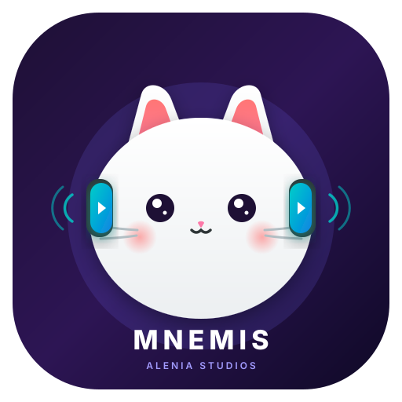

<p align="center">
  
</p>

<h1 align="center">Mnemis</h1>

<p align="center">
  <a href="https://github.com/Kaia-Alenia/Mnemis/actions/workflows/android.yml"></a>
  <a href="https://github.com/Kaia-Alenia/Mnemis"></a>
  <a href="https://kotlinlang.org/"></a>
  <a href="https://gradle.org/"></a>
  <a href="https://github.com/Kaia-Alenia/Mnemis/blob/main/SECURITY.md"></a>
</p>

<p align="center"><b>An extensible Android video player with native KoalaSync watch parties.</b></p>

**Mnemis is an extensible Android video player built by Alenia Studios.**

It brings local playback, direct web streams, and synchronized watch parties together in one player. Its native KoalaSync integration lets people join a room and coordinate play, pause, and seek actions while watching supported media sources.

[Read this in Spanish](README.es.md)

## What Mnemis does

- Plays local video files and direct HTTP(S) media URLs.
- Uses AndroidX Media3 for playback, including HLS and DASH support.
- Resolves supported links such as YouTube, Google Drive, Dropbox, and direct MP4/HLS streams.
- Opens web-based players through an Android WebView when a source requires it.
- Supports picture-in-picture and common Android video intents.
- Connects to KoalaSync rooms through a native WebSocket client.
- Synchronizes playback state between participants, including play, pause, seek, room membership, and controller modes.
- Provides a foundation for source and player plugins so integrations can evolve independently from the core player.

## KoalaSync watch parties

KoalaSync is Mnemis's native watch-party integration. A participant can create or join a room, optionally provide a display name and room password, and share playback actions with other connected peers.

The integration supports:

- Room discovery through a room ID.
- `everyone` and `host-only` control modes.
- Playback synchronization with sequence numbers and drift correction.
- Automatic heartbeat and reconnect handling.
- Web playback through a JavaScript bridge for HTML5 video sources.

KoalaSync synchronizes playback commands and metadata; it does not copy or redistribute the media itself. Every participant must have the right to access the content they watch.

## Supported sources

| Source | Current behavior |
| --- | --- |
| Local files | Opened through Android video intents and the system file picker |
| Direct MP4 and other progressive streams | Played with Media3 |
| HLS (`.m3u8`) | Played with Media3 HLS support |
| DASH | Supported by the Media3 DASH module |
| YouTube links | Resolved when the source response permits it; availability may change |
| Google Drive links | Converted to a direct download/stream URL when accessible |
| Dropbox links | Direct-download links are supported |
| Other websites | Opened through the web player when compatible |

Third-party platforms can change their APIs, authentication, terms, or delivery formats. Mnemis does not guarantee permanent compatibility with any external service.

## Plugin architecture

Mnemis is designed around replaceable media-source and playback integrations. The current native KoalaSync integration is the first reference plugin-like integration. The public plugin contract is still evolving; see [Plugin development](docs/PLUGIN_DEVELOPMENT.md) before building an external integration.

Plugins should:

1. Declare the sources and permissions they need.
2. Return normalized media metadata and a playable source.
3. Keep platform-specific code outside the core player.
4. Avoid collecting data that is not required for playback.
5. Handle failures explicitly and respect the source platform's rules.

## Building

### Requirements

- Android Studio Hedgehog or newer.
- JDK 17.
- Android SDK 34.
- An Android device or emulator running API 24 or newer.

### Commands

```bash
./gradlew assembleDebug
./gradlew test
```

Install the debug APK from `app/build/outputs/apk/debug/` on a test device. Do not use production accounts or private media credentials in debug builds.

## Project layout

```text
app/src/main/java/com/alenia/mnemis/
  model/       Media models
  player/      Media3 playback and gesture helpers
  resolver/    Link and media-source resolution
  sync/        KoalaSync client, protocol, and WebView bridge
  ui/          Android activities and adapters
src/android/   Shared Android resolver code
assets/        Branding assets
docs/          Technical documentation
```

## Privacy and security

Mnemis needs network access to resolve remote media and connect to KoalaSync. Room participants may receive playback metadata such as a peer ID, display name, media title, and playback position. See [PRIVACY.md](PRIVACY.md) and [SECURITY.md](SECURITY.md).

Do not include API keys, room passwords, cookies, or personal credentials in issues, pull requests, logs, or source code. If you discover a security issue, report it privately using the process in [SECURITY.md](SECURITY.md).

## Contributing

Bug reports, source integrations, translations, tests, and documentation improvements are welcome. Read [CONTRIBUTING.md](CONTRIBUTING.md) and [CODE_OF_CONDUCT.md](CODE_OF_CONDUCT.md) first.

## Support

For usage questions and feature requests, see [SUPPORT.md](SUPPORT.md). Please include the Mnemis version, Android version, source type, and reproducible steps without sharing private content or credentials.

## License

No license has been published in this repository yet. Until a license is added, all rights remain with the copyright holder and reuse should not be assumed.
