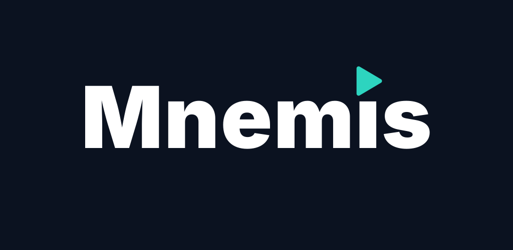

<p align="center">
  
</p>

<h1 align="center">Mnemis</h1>

<p align="center">
  <a href="https://github.com/Kaia-Alenia/Mnemis/actions/workflows/android.yml"></a>
  <a href="https://github.com/Kaia-Alenia/Mnemis/releases"></a>
  <a href="LICENSE"></a>
  <a href="https://github.com/Kaia-Alenia/Mnemis"></a>
  <a href="https://kotlinlang.org/"></a>
  <a href="https://gradle.org/"></a>
</p>

<p align="center"><i>An extensible Android video player with native KoalaSync watch parties. Play local files, direct streams and web players in one place, and watch together in sync.</i></p>

<p align="center"><a href="CHANGELOG.md"><b>Latest release: v1.0.9</b> — See what's changed in the Changelog</a></p>

**Mnemis is an extensible Android video player built by Alenia Studios.**

It brings local playback, direct web streams, and synchronized watch parties together in one player. Its native KoalaSync integration lets people join a room and coordinate play, pause, and seek actions while watching supported media sources.

[Read this in Spanish](README.es.md)

## Why Mnemis

- **Plugin-first**: The player core stays small. Sources and playback integrations ship as plugins, so new services can be added without changing the core player.
- **Watch together**: Native KoalaSync watch parties with play, pause, and seek synchronization, host controls, and automatic reconnection.
- **Plays almost anything**: Local files, direct MP4/HLS/DASH streams, YouTube, Google Drive, Dropbox links, and web players through WebView.
- **Built on Media3**: AndroidX Media3 playback with HLS and DASH support, picture-in-picture, and standard Android video intents.
- **Open and private**: Open source under the MIT License. No account is required to play local or direct media, and no media is copied or redistributed by the sync integration.

## Key Features

- **Local playback**: Open video files from storage through the system file picker and Android video intents.
- **Direct streams**: Play direct HTTP(S) media URLs, including progressive MP4, HLS (`.m3u8`), and DASH.
- **Link resolution**: Resolve supported links such as YouTube, Google Drive, and Dropbox into playable streams when the source permits it.
- **Web players**: Open web-based players through an Android WebView when a source requires it.
- **KoalaSync watch parties**: Create or join a room, set a display name and optional room password, and sync playback with other participants. See [KoalaSync watch parties](#koalasync-watch-parties) below.
- **Picture-in-picture**: Keep watching while using other apps.
- **Built-in plugins**: Mnemis ships with four built-in plugins:
  - **KoalaSync** — synchronized watch parties over WebSocket, with room state, heartbeat, and drift correction.
  - **Web AdBlocker** — blocks network ad trackers and YouTube pre-roll placements in web playback.
  - **YouTube SPA Bridge** — handles YouTube single-page-app navigation and `#movie_player` controls.
  - **Universal Web Players** — adds playback support for generic web players through injected user scripts.

## Quick Start

### Requirements

- Android Studio Hedgehog or newer.
- JDK 17.
- Android SDK 34.
- An Android device or emulator running API 24 or newer.

### Build and install

```bash
./gradlew assembleDebug
./gradlew test
```

Install the debug APK from `app/build/outputs/apk/debug/` on a test device. Do not use production accounts or private media credentials in debug builds.

Tagged releases are also built by CI (`.github/workflows/android.yml`), which runs tests, assembles the debug APK, and publishes it as a GitHub release. Download the latest APK from the [releases page](https://github.com/Kaia-Alenia/Mnemis/releases).

### How to use

1. Open Mnemis and pick a video: a local file, a direct stream URL, or a supported link.
2. To watch together, open the KoalaSync panel, create or join a room with a room ID, and share the room ID with your friends.
3. Play, pause, or seek — everyone in the room stays in sync.

## Supported sources

| Source | Current behavior |
| --- | --- |
| Local files | Opened through Android video intents and the system file picker |
| Direct MP4 and other progressive streams | Played with Media3 |
| HLS (`.m3u8`) | Played with Media3 HLS support |
| DASH | Supported by the Media3 DASH module |
| YouTube links | Resolved when the source response permits it; availability may change |
| Google Drive links | Converted to a direct download/stream URL when accessible |
| Dropbox links | Direct-download links are supported |
| Other websites | Opened through the web player when compatible |

Third-party platforms can change their APIs, authentication, terms, or delivery formats. Mnemis does not guarantee permanent compatibility with any external service.

## KoalaSync watch parties

KoalaSync is Mnemis's native watch-party integration. A participant can create or join a room, optionally provide a display name and room password, and share playback actions with other connected peers.

The integration supports:

- Room discovery through a room ID.
- `everyone` and `host-only` control modes.
- Playback synchronization with sequence numbers and drift correction.
- Automatic heartbeat and reconnect handling.
- Web playback through a JavaScript bridge for HTML5 video sources.

KoalaSync synchronizes playback commands and metadata; it does not copy or redistribute the media itself. Every participant must have the right to access the content they watch.

KoalaSync is an independent open-source project by Shik3i. Learn more at the [KoalaSync website](https://sync.koalastuff.net/) and the [KoalaSync GitHub repository](https://github.com/Shik3i/KoalaSync). Technical details of the Mnemis integration are in [docs/KOALASYNC.md](docs/KOALASYNC.md).

## Localization

Mnemis ships with interface translations for these languages:

- English (`en`)
- German (`de`)
- Spanish (`es`)
- French (`fr`)
- Italian (`it`)
- Japanese (`ja`)
- Korean (`ko`)
- Dutch (`nl`)
- Polish (`pl`)
- Portuguese (`pt`)
- Brazilian Portuguese (`pt-BR`)
- Russian (`ru`)
- Turkish (`tr`)
- Ukrainian (`uk`)
- Chinese, Simplified (`zh-CN`)

Community translations are welcome. If you can translate Mnemis into another language, see [CONTRIBUTING.md](CONTRIBUTING.md).

## Plugin development

Mnemis is designed around replaceable media-source and playback integrations. The current native KoalaSync integration is the first reference plugin-like integration. The public plugin contract is still evolving; see [Plugin development](docs/PLUGIN_DEVELOPMENT.md) before building an external integration.

Plugins should:

1. Declare the sources and permissions they need.
2. Return normalized media metadata and a playable source.
3. Keep platform-specific code outside the core player.
4. Avoid collecting data that is not required for playback.
5. Handle failures explicitly and respect the source platform's rules.

## Project layout

```text
app/src/main/java/com/alenia/mnemis/
  model/       Media models
  player/      Media3 playback and gesture helpers
  plugin/      Built-in plugins and plugin registry
  resolver/    Link and media-source resolution
  sync/        KoalaSync client, protocol, and WebView bridge
  ui/          Android activities and adapters
src/android/   Shared Android resolver code
assets/        Branding assets
docs/          Technical documentation
```

## Documentation & Links

- **[docs/KOALASYNC.md](docs/KOALASYNC.md)**: KoalaSync integration, room lifecycle, events, and web playback.
- **[docs/PLUGIN_DEVELOPMENT.md](docs/PLUGIN_DEVELOPMENT.md)**: Plugin responsibilities, recommended flow, and design guidance.
- **[PRIVACY.md](PRIVACY.md)**: Data handling and privacy policy.
- **[SECURITY.md](SECURITY.md)**: Disclosure policy and security practices.
- **[CONTRIBUTING.md](CONTRIBUTING.md)**: How to help make Mnemis better.
- **[CODE_OF_CONDUCT.md](CODE_OF_CONDUCT.md)**: Community standards and expectations.
- **[SUPPORT.md](SUPPORT.md)**: Where to ask questions and report issues.
- **[KoalaSync website](https://sync.koalastuff.net/)**: The reference watch-party project — create rooms and learn how sync works.
- **[KoalaSync on GitHub](https://github.com/Shik3i/KoalaSync)**: Source code of the KoalaSync extension and relay server.
- **[Mnemis releases](https://github.com/Kaia-Alenia/Mnemis/releases)**: Published APKs and version history.

## Privacy and security

Mnemis needs network access to resolve remote media and connect to KoalaSync. Room participants may receive playback metadata such as a peer ID, display name, media title, and playback position. See [PRIVACY.md](PRIVACY.md) and [SECURITY.md](SECURITY.md).

Do not include API keys, room passwords, cookies, or personal credentials in issues, pull requests, logs, or source code. If you discover a security issue, report it privately using the process in [SECURITY.md](SECURITY.md).

## Contributing

Bug reports, source integrations, translations, tests, and documentation improvements are welcome. Read [CONTRIBUTING.md](CONTRIBUTING.md) and [CODE_OF_CONDUCT.md](CODE_OF_CONDUCT.md) first.

## Support

For usage questions and feature requests, see [SUPPORT.md](SUPPORT.md). Please include the Mnemis version, Android version, source type, and reproducible steps without sharing private content or credentials.

## License

Mnemis is open source under the MIT License. See [LICENSE](LICENSE).

---

<div align="center">
  <sub>Built by <a href="https://github.com/Kaia-Alenia">Alenia Studios</a>. Mnemis is open source under the <a href="LICENSE">MIT License</a>.</sub>
</div>
